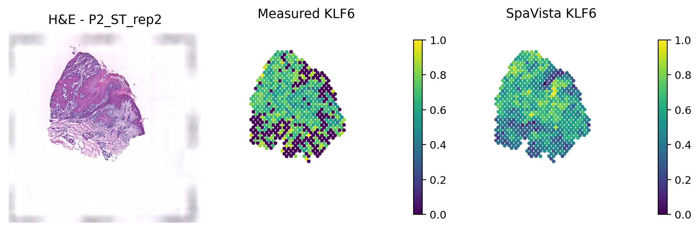

Quick demo: cSCC-HVG fold 0
===========================

This demo evaluates a trained fold-0 prediction head on three held-out cSCC slides: ``P2_ST_rep1``, ``P2_ST_rep2``, and ``P2_ST_rep3``. It performs inference and evaluation without retraining.

Install SpaVista and download the encoder checkpoint and demo assets from the repository root:

.. code-block:: bash

   python scripts/download_hf_assets.py --checkpoint --demo

The executable `demo notebook <https://github.com/NingZhangCSUBio/SpaVista/blob/main/demo/sge_fold0/SpaVista_SGE_fold0_demo.ipynb>`_ contains the same cells and saved outputs shown below. Select the ``SpaVista`` kernel and run the cells in order.

Set up the notebook
-------------------

.. code-block:: python

   from pathlib import Path
   import sys

   repo_root = next(
       (path for path in (Path.cwd(), *Path.cwd().parents)
        if (path / 'demo' / 'sge_fold0' / 'run_demo.py').is_file()),
       None,
   )
   if repo_root is None:
       raise FileNotFoundError('Start Jupyter from the SpaVista repository or one of its subdirectories.')

   DEVICE_NUM = 0
   BATCH_SIZE = 16
   print('SpaVista repository detected.')
   print(f'CUDA device index: {DEVICE_NUM}')

.. code-block:: text

   SpaVista repository detected.
   CUDA device index: 0

Run inference and evaluation
----------------------------

.. code-block:: python

   import subprocess

   completed = subprocess.run(
       [sys.executable, str(repo_root / 'demo' / 'sge_fold0' / 'run_demo.py'),
        '--device-num', str(DEVICE_NUM), '--batch-size', str(BATCH_SIZE)],
       cwd=repo_root,
       stdout=subprocess.PIPE,
       stderr=subprocess.PIPE,
       text=True,
   )
   if completed.returncode != 0:
       raise RuntimeError('Demo failed. Run demo/sge_fold0/run_demo.py from a terminal to inspect the full log.')
   print('Fold-0 inference and evaluation complete.')

.. code-block:: text

   Fold-0 inference and evaluation complete.

Display results
---------------

.. code-block:: python

   import pandas as pd
   from IPython.display import Image, display

   output_dir = repo_root / 'results' / 'demo' / 'cscc_hvg_fold0'
   metrics = pd.read_csv(output_dir / 'median_performance_metrics.csv')
   display(metrics[['slice_idx', 'medpcc_gene', 'med_spearman_gene']].round(4))
   print(f"Median gene PCC: {metrics['medpcc_gene'].median():.4f}")
   print(f"Median gene SCC: {metrics['med_spearman_gene'].median():.4f}")
   display(Image(filename=str(output_dir / 'figures' / 'P2_ST_rep2_KLF6.png'), width=800))

.. code-block:: text

      slice_idx  medpcc_gene  med_spearman_gene
   0          0       0.3140             0.3074
   1          1       0.3209             0.3159
   2          2       0.3375             0.3273

   Median gene PCC: 0.3209
   Median gene SCC: 0.3159

The demo writes metrics, predictions, gene correlations, and the figure under ``results/demo/cscc_hvg_fold0/``. On an NVIDIA RTX A6000 with batch size 16 and GPU 1, the three-slide demo completed in 75.2 seconds. These are fold-0 demo results, not the four-fold aggregate.
