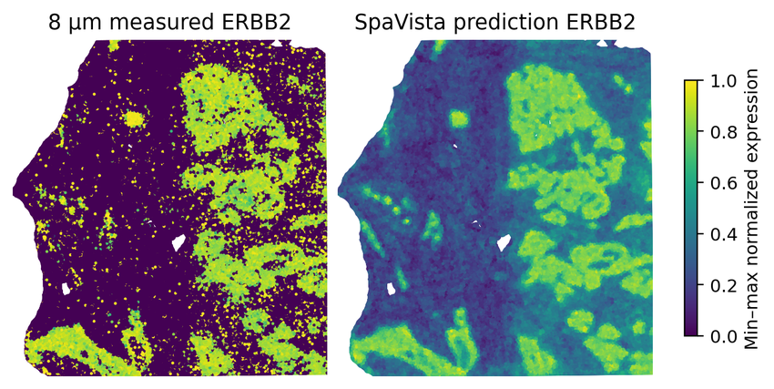

Visium HD high-resolution inference
===================================

Complete :doc:`installation` and :doc:`data`, then run the following two code blocks in order from the repository root.

Training and testing
--------------------

.. literalinclude:: _includes/high_resolution_train_test.py
   :language: python

Visualization
-------------

.. literalinclude:: _includes/high_resolution_visualization.py
   :language: python

   High-resolution ERBB2 example.
