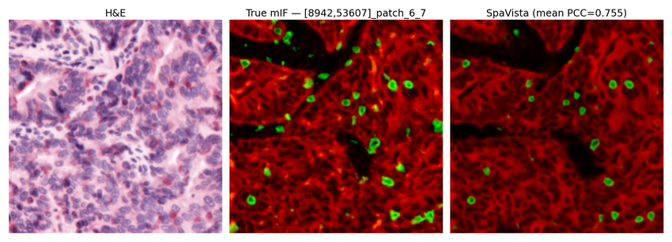

H&E-to-mIF image generation
===========================

Complete :doc:`installation` and :doc:`data`, then run the following two code blocks in order from the repository root.

Training and testing
--------------------

.. literalinclude:: _includes/mif_generation_train_test.py
   :language: python

Visualization
-------------

.. literalinclude:: _includes/mif_generation_visualization.py
   :language: python

   mIF image-generation example.
