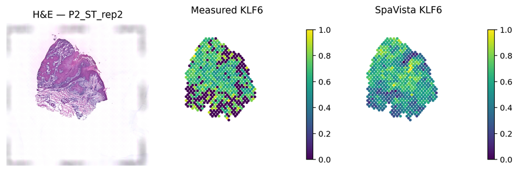

Spatial gene expression prediction
==================================

Complete :doc:`installation` and :doc:`data`, then run the following two code blocks in order from the repository root. Set ``SGE_FOLD`` in the first block to choose a fold.

Training and testing
--------------------

.. literalinclude:: _includes/spatial_gene_expression_train_test.py
   :language: python

Visualization
-------------

.. literalinclude:: _includes/spatial_gene_expression_visualization.py
   :language: python

   cSCC fold-0 spatial expression example.
