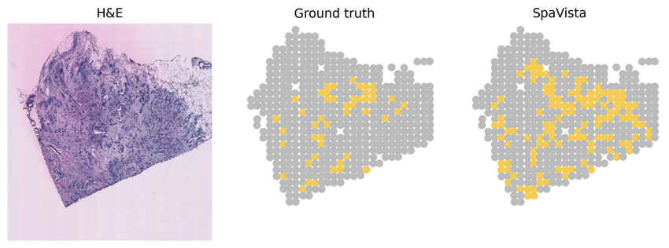

Tumor detection
===============

Complete :doc:`installation` and :doc:`data`, then run the following two code blocks in order from the repository root.

Training and testing
--------------------

.. literalinclude:: _includes/tumor_detection_train_test.py
   :language: python

Visualization
-------------

.. literalinclude:: _includes/tumor_detection_visualization.py
   :language: python

   Tumor detection example.
